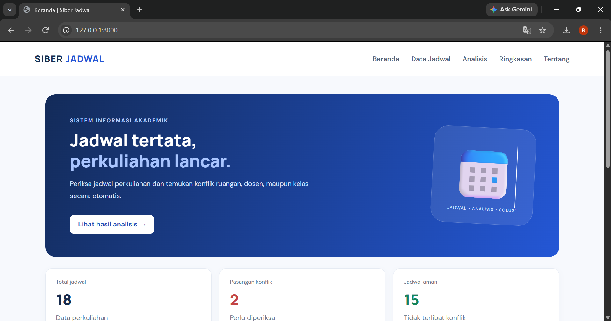
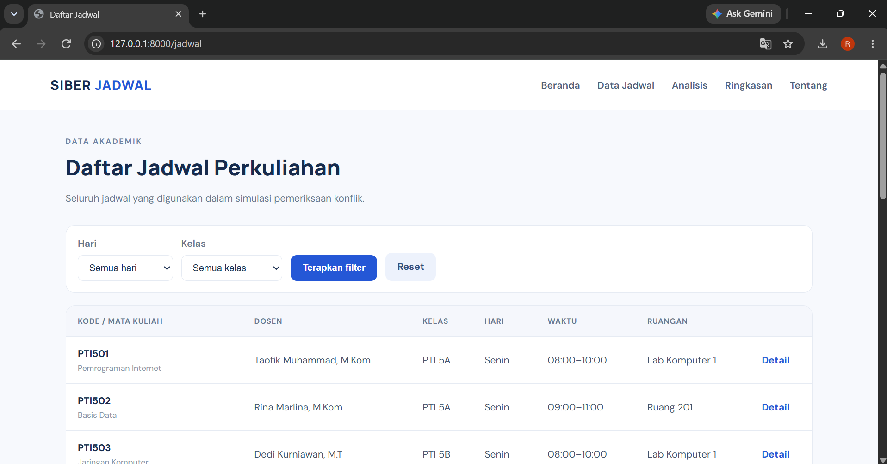
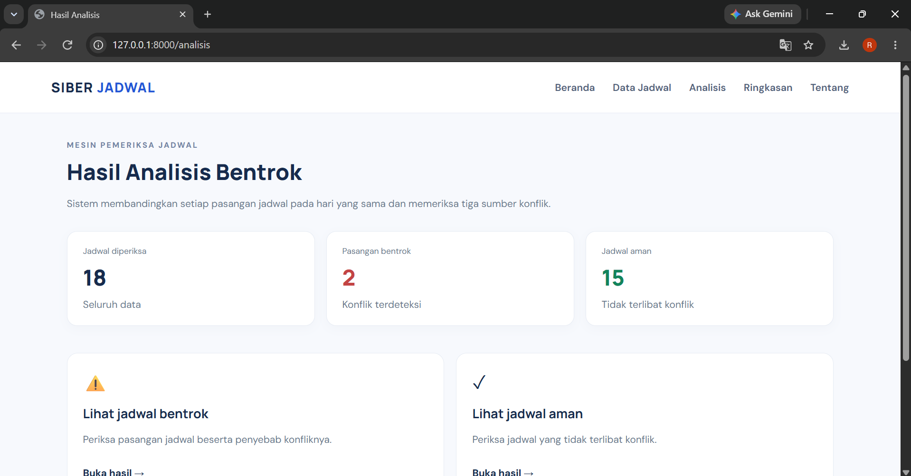
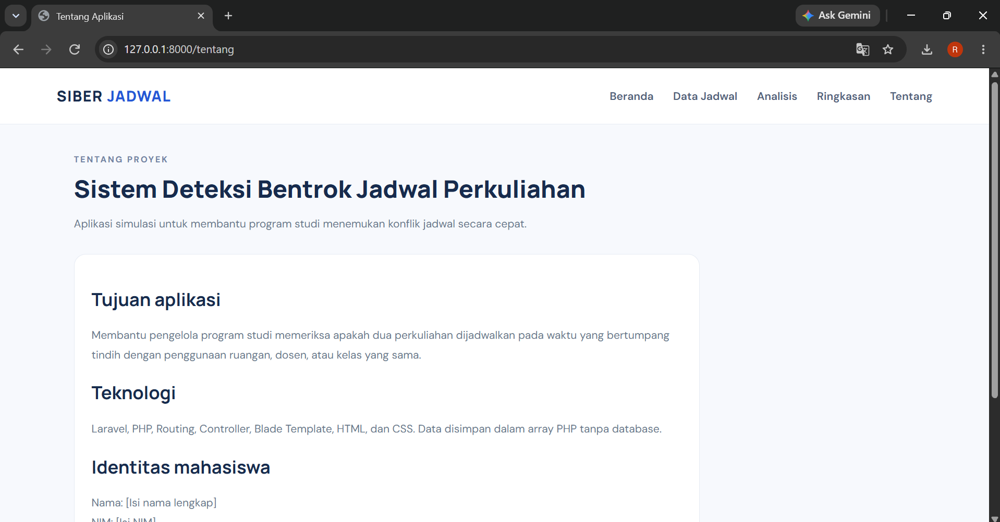

# APLIKASI JADWAL BENTROK

## 1. Identitas Mahasiswa

| Keterangan | Data |
|---|---|
| Nama Lengkap | Riza Fitria |
| NIM | C2483207031 |
| Kelas | PTI5 |
| Mata Kuliah | Pemrograman Internet |
| Jenis Tugas | Ujian Tengah Semester (UTS) |

## 2. Judul Proyek

**Aplikasi Pendeteksi Jadwal Bentrok Berbasis Web Menggunakan Framework Laravel**

## 3. Deskripsi Permasalahan dan Solusi

### Permasalahan

Penyusunan jadwal sering mengalami kendala, salah satunya adalah terjadinya jadwal yang bertabrakan. Contohnya, dua kegiatan atau mata kuliah memiliki waktu pelaksanaan yang sama sehingga dapat menyebabkan kesulitan dalam mengatur kegiatan.

Pengecekan jadwal secara manual juga membutuhkan waktu dan berisiko menimbulkan kesalahan.

### Solusi

Untuk mengatasi permasalahan tersebut, dikembangkan aplikasi Jadwal Bentrok berbasis web menggunakan framework Laravel.

Aplikasi ini bertujuan membantu pengguna dalam mengelola jadwal dan mengetahui apakah terdapat waktu pelaksanaan yang saling bertabrakan.

Dengan adanya aplikasi ini, proses pengecekan jadwal diharapkan menjadi lebih mudah, cepat, dan terstruktur.

## 4. Implementasi Routing, Controller, dan Blade View

Aplikasi ini menggunakan konsep arsitektur Laravel yang memisahkan pengaturan alamat halaman, proses pengolahan data, dan tampilan aplikasi.

### A. Routing

Routing digunakan untuk mengatur alamat atau URL yang dapat diakses oleh pengguna.

Konfigurasi routing pada Laravel terdapat dalam file:

`routes/web.php`

Routing berfungsi menghubungkan permintaan pengguna dengan fungsi yang terdapat pada Controller.

### B. Controller

Controller berfungsi sebagai penghubung antara Routing, Model, dan View.

Controller bertugas:
- Menerima permintaan dari pengguna.
- Memproses data jadwal.
- Melakukan pengecekan kemungkinan bentrok.
- Mengirimkan hasil pengolahan data ke halaman tampilan.

Controller disimpan pada folder:

`app/Http/Controllers/`

### C. Blade View

Blade View digunakan untuk menampilkan halaman antarmuka aplikasi kepada pengguna.

Blade merupakan template engine bawaan Laravel yang memungkinkan penggunaan HTML dan sintaks khusus Laravel.

File tampilan disimpan pada folder:

`resources/views/`

Blade View digunakan untuk menampilkan informasi jadwal, formulir pengisian, dan hasil pengecekan jadwal.

## 5. Logika Perhitungan dan Analisis

Logika utama aplikasi adalah melakukan pengecekan terhadap waktu mulai dan waktu selesai dari setiap jadwal.

Pengecekan dilakukan dengan membandingkan dua rentang waktu.

Misalnya:

- Jadwal A: 08.00–10.00
- Jadwal B: 09.00–11.00

Kedua jadwal tersebut mengalami bentrok karena memiliki waktu pelaksanaan yang bersamaan.

Secara logika, kondisi bentrok dapat diperiksa menggunakan rumus:

`waktu_mulai_A < waktu_selesai_B && waktu_mulai_B < waktu_selesai_A`

Apabila kondisi tersebut bernilai benar, berarti kedua jadwal mengalami bentrok.

Sebaliknya, apabila kondisi tersebut bernilai salah, berarti kedua jadwal tidak mengalami bentrok.

**Contoh analisis:**

| Jadwal | Mulai | Selesai | Keterangan |
|---|---|---|---|
| A | 08.00 | 10.00 | - |
| B | 09.00 | 11.00 | Bentrok |
| C | 10.00 | 12.00 | Tidak bentrok dengan A |

Logika ini digunakan untuk membantu mengurangi kesalahan dalam penyusunan jadwal.

## 6. Screenshot Hasil Aplikasi

Berikut merupakan dokumentasi tampilan aplikasi Jadwal Bentrok.

## Beranda


## Daftar Jadwal


## Hasil Deteksi Bentrok


## Tentang Aplikasi


## 7. Petunjuk Menjalankan Aplikasi

Berikut langkah-langkah untuk menjalankan aplikasi pada komputer:

### Persyaratan

- PHP
- Composer
- MySQL
- Laravel
- Git

### Langkah Instalasi

**1. Clone repository**

```bash
git clone https://github.com/rizafitria/UTS-Pemrograman-Internet-C2483207031.git
```

**2. Masuk ke folder project**

```bash
cd UTS-Pemrograman-Internet-C2483207031
```

**3. Install dependency**

```bash
composer install
```

**4. Salin file konfigurasi**

```bash
copy .env.example .env
```

**5. Generate application key**

```bash
php artisan key:generate
```

**6. Atur database**

Sesuaikan konfigurasi database pada file `.env`, meliputi nama database, username, dan password.

**7. Jalankan migrasi database**

```bash
php artisan migrate
```

**8. Jalankan aplikasi**

```bash
php artisan serve
```

**9. Buka aplikasi melalui browser**

```text
http://127.0.0.1:8000
```

## 8. Kesimpulan

Aplikasi Jadwal Bentrok merupakan aplikasi berbasis web yang dikembangkan menggunakan framework Laravel sebagai penerapan materi Pemrograman Internet.

Melalui proyek ini, mahasiswa dapat memahami penerapan Routing, Controller, Blade View, serta logika perbandingan waktu dalam pengembangan aplikasi web.

Diharapkan aplikasi ini dapat membantu proses pengelolaan jadwal agar lebih efektif dan mengurangi kemungkinan terjadinya jadwal yang bertabrakan.
